<picture>
  <source media="(prefers-color-scheme: dark)" srcset="assets/header-dark.svg">
  
</picture>

### Building [Waypoint](https://waypoint.ing)

Waypoint gives your AI assistants one profile: your memory, your work, and the tools to do real jobs. Connect it once and it works in ChatGPT, Claude and the other AI tools you use.

Mostly Go on the backend, with a Next.js portal on top.

### Before this

- **Bluely.ai**, cofounder and CEO. Connected an enterprise's databases into a knowledge graph so teams could build their own generative AI apps on it.
- **Senior architect**, distributed systems, Chennai.
- **Senior product specialist**, UK.

Eighteen years of building the layer that sits between messy systems and the people who want to use them.

### What I work with

```
go · postgres · redis · nats jetstream · grpc · opentelemetry
typescript · next.js · react
azure · kubernetes · docker · github actions
mcp · oauth 2.1 · llm tooling
```

<br>

<picture>
  <source media="(prefers-color-scheme: dark)" srcset="https://raw.githubusercontent.com/graydeveloper01/graydeveloper01/output/snake-dark.svg">
  
</picture>

<br>

[waypoint.ing](https://waypoint.ing) · [X @narasimhanr_](https://x.com/narasimhanr_) · [LinkedIn](https://www.linkedin.com/in/narasimhan-rengan/)
